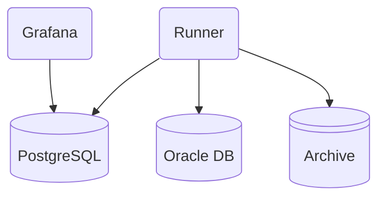

# VisCalMon

This library contains all you could need about radar visualization, calibration and monitoring, hence its name.

It offers experimental calibration scripts, a complete dual-pol monitoring software, a QPE (*Quantitative Precipitation Estimation*) quality control unit, a radar raw data on-the-fly viewer, and some multi-purpose Python utilities.

It is developped to work in the *Royal Meteorological Institute of Belgium* IT environment.

# Dependencies and requirements

This library uses the following libraries:
- [Docker](https://www.docker.com/)
- [Flask](https://flask.palletsprojects.com/en/stable/)
- [Grafana](https://grafana.com/) (version >= 13)
- [NumPy](https://numpy.org/)
- [Matplotlib](https://matplotlib.org/)
- [OpenCV](https://opencv.org/)
- [pandas](https://pandas.pydata.org/)
- [PostgreSQL](https://www.postgresql.org/) (version >= 18)
- [Psycopg](https://www.psycopg.org/)
- [PyArrow](https://arrow.apache.org/docs/python/index.html)
- [pyproj](https://pyproj4.github.io/pyproj/stable/)
- [Python](https://www.python.org/)
- [python-oracledb](https://oracle.github.io/python-oracledb/)
- [SciPy](https://scipy.org/)
- [$\omega radlib$](https://wradlib.org/)
- [Xarray](https://xarray.dev/)

It automatically installs and runs in docker containers. As a consequence, you'll need the docker deamon installed and the permissions to access it.

It is recommended to run it on a server with enough space, memory (at least 16GB) and computational power.
If you don't have this available, the running time will be significantly increased.

# Layout

**Runner:** contains the VisCalMon python library and exports the statistics to the **PostgresSQL** database  
**Oracle DB:** contains the rain gauges data  
**Archive**: contains the radar data  
**Grafana:** allows you to visualize the data from the **PostgreSQL** database

Both the **Grafana** and **PostgreSQL** units can be set up outside of the VisCalMon environment if you have already running instances.  
The database must respect the schema in `schema.sql`.  
Please also check the minimum required versions.

# Files and folders organization

- `docs/`: Documentation files. Meant to be opened with Obsidian.
- `grafana/`: Dockerfile and configuration files for Grafana
- `viscalmon-lib/`
    - `scripts/`: Prepared sequences for calibration and monitoring. Automatically added to the container `PATH`.
    - `viscalmon/`: Python library
- `compose.*.yaml`: Docker compose files
- `entrypoint.*.sh`: Docker entrypoints
- `{launch/logs/stop}_docker*.sh`: utilities to run containers, stop containes or get the logs from the containers
- `{dump/restore}_db.sh`: utilities to save and restore the Postgres database

# Usage

### First step: environment file

Copy the `.env.example` environment file as `.env`.

Fill it in with the credentials to use to connect to the Postgres (can be different from the VisCalMon one) and Oracle (for rain gauges) databases, the host path where the logs will be written and the group that'll be used to write them.

### *Optional*: start the VisCalMon Postgres and Grafana instances

Copy the `.env.postgres.example` environment file as `.env.postgres`.

Fill it in with the credentials the dockered Postgres database will be initialized with.

You can see and change the port the Grafana instance is exposed on by editing `compose.daemons.yaml`.

Start the Grafana and Postgres instances by running `launch_docker_daemons.sh`.

You can stop the containers with the following commands: `stop_docker_daemons.sh` and `stop_docker_daemons_and_delete_volume.sh` if you also want to delete the docker volume that stores database data.
You can either use the raw command or pass the name of the container to stop: `grafana` or `db`.

##### Grafana

The Grafana instance embedded in VisCalMon is a **development** instance. It means it's not configured deeply.

For exemple, both the adminitrator username and password are "admin".

See the detailed documentation in `docs/` for more details.

### Runner

The runner is a tuned Python 3.14 docker image.

To run it you can either:
- Run `launch_docker_runner.sh`: it starts a bash interpreter
- Run `launch_docker_runner.sh <command>`: it starts your command and closes the container after

### DPOL Monitoring

The library exposes the command `daily_monitoring` to run the monitoring statistics computation on a certain period for one radar.

Usage : `daily_monitoring <radar> <(start_)date> [<end_date>]`  
With both dates with `YYYYMMDD` format.

All the monitoring statistics are made together, day by day. Every time it's run, each program dedicated to a specific monitoring type adds its daily statistics to the corresponding table in the **PostgreSQL** database.

If you stop the main script, the already computed daily statistics aren't lost.
If you re-launch the script, it will eventually recompute the days for which the statistics have already been computed.

The logs are direcly wrote to the standard output.

Please check `viscalmon.dpol_monitoring.daily` for more information.

### QPE Quality control

The library proposes various prepared sequences you can find in `viscalmon-lib/scripts/` (also added to the `PATH`): `run_all*.sh`.

The usage is always the same: `<script> <start> <end> <max number of comparisons in parallel>`  
Where `start` and `end` format is either `YYYYMMDD` or `YYYYMM` depending on the comparison led.

The logs are wrote in the `LOGS_DIR` folder (see `.env`) with the following scheme: `$LOGS_DIR/<comparison type>/<start>-<end>/`.

> **IMPORTANT** The logs a very detailed. Please make sure the folder doesn't fill to much storage.

Please check `viscalmon.qpe_qc` for more information.

### Radar raw data viewer (*Work-In-Progress*)

This unit aims to propose a viewer for the raw polarimetric data: $Z$, unfiltered $Z$, $Z_{DR}$, $\rho_{HV}$, $\phi_{DP}$, unfiltered $\phi_{DP}$, $K_{DP}$ and radial velocities.

To start it, run `launch_docker_viewer.sh`.  
To stop it, run `stop_docker_viewer.sh` or `stop_docker_viewer_and_delete_volume.sh` if you also want to delete the docker volume that stores the images.  
Too see the logs, run `logs_docker_viewer.sh`.

For more details about its operation, please read the associated docs.

### Radar calibration (*experimental*)

> **IMPORTANT** This unit is experimental and hasn't been tested deeply after its integration in the VisCalMon library. Please consider checking and adapting it before using it.

This unit serves calibration estimation schemes.

To use it, you need to edit and run `viscalmon-lib/scripts/run_calib.sh` (also added to the `PATH`).  
It contains an array where you can put all the calibration periods to be run.  
You can comment a line if you don't want it to be run.  
The columns are :
- The radar name in lower case (jabbeke, wideumont)
- The begin timestamp (YYYYMMDDHHMM)
- The end timestamp (YYYYMMDDHHMM)

**Please do not add or remove any columns without modifying all the script.**

The three calibration methods are run together, so please make sure there's always rain above the radar for the BirdBath  calibration method

**Main script**
1. The main script verifies all the given parameters
2. It retrieves the vertical and volume scans (their name and path) and the mid-period composite simultaneously
3. It runs all the calibrations simultaneously

**If you want to stop it, just hit `Ctrl+C`. The script automatically kills all children tasks.**

The archives are automatically retrieved in `/mnt/HDS_ERS/archive/HHHH/MM/DD/single/radar/`.

For the $Z$ calibration method, there is a `SHOW_PIXELS_USED` variable you can set to `True` if you want to see all the rain path finding step. It will only display it for the $0.9^\circ$ elevation, else the are too many plots.  
**Don't use it operationally as it opens windows instead of saving the plots**

As things stand, the result are exported in the `/data_out/` folder in the container but not outside of it.  
To export them outside, please refer to the same method as for the QPE quality control logs.

Folders names:

- `zdr_vertical/`: BirdBath $Z_{DR}$ calibration
- `zdr_consistency/`: $Z$ to $Z_{DR}$ consistency calibration
- `z_consistency/`: $Z$, $Z_{DR}$, $K_{DP}$ consistency calibration
- `composite/`: for each time period run, the main script saves a rainfall rate composite at mid-period. It's just to have an idea of what the situation looks like.

Filenames convention:
- `<radar>_<begin_timestamp>_<end_timestamp>.png` for the plots
- `<begin_timestamp>_<end_timestamp>.png` for the composites

For more information, please read the associated docs.

# Credits and contact

Fully developped by Aurélien Verbeke (french intern from ENSEEIHT engineering school) at the *Royal Meteorological Institute of Belgium* during 2025 and 2026 summers.

Mail: <pro.aurelien.verbeke@gmail.com>

DPOL monitoring algorithms are derived from Météo-France's operational radar monitoring.

QPE quality control schemes are based on Edouard Goudenhoofdt's work.

# License

This library is licensed under **GNU QPLv3** license.